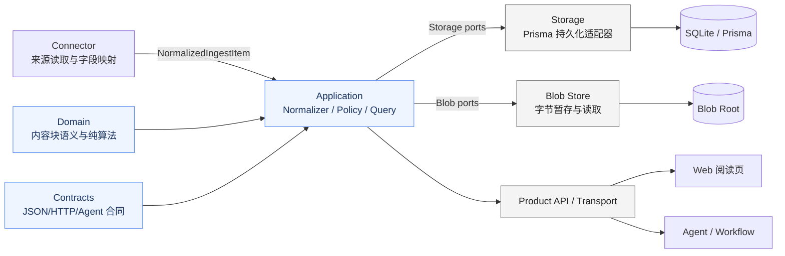
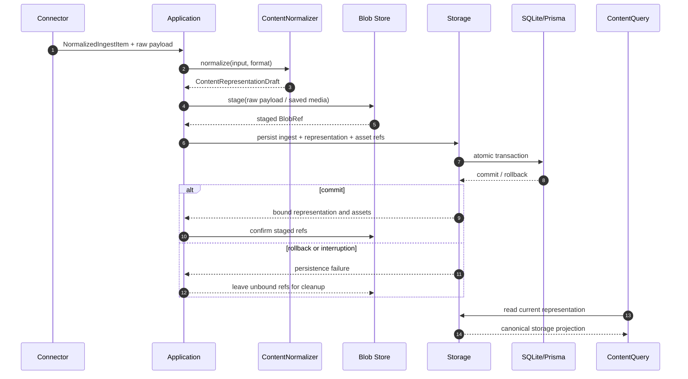
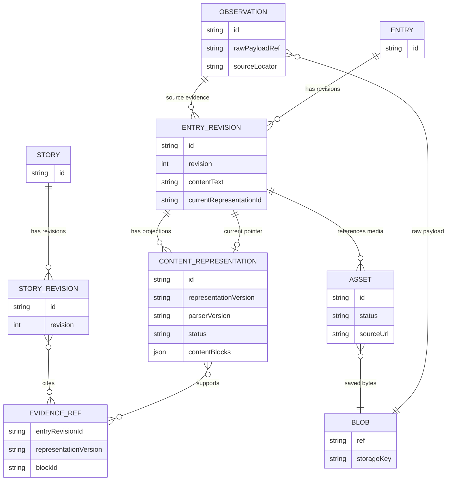
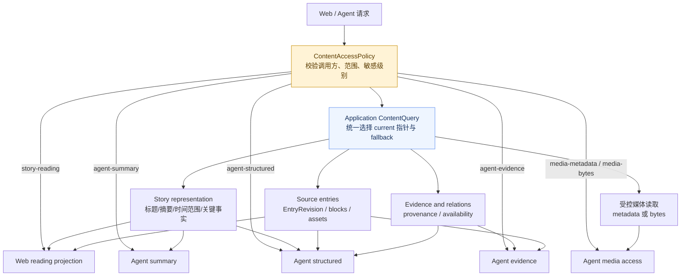
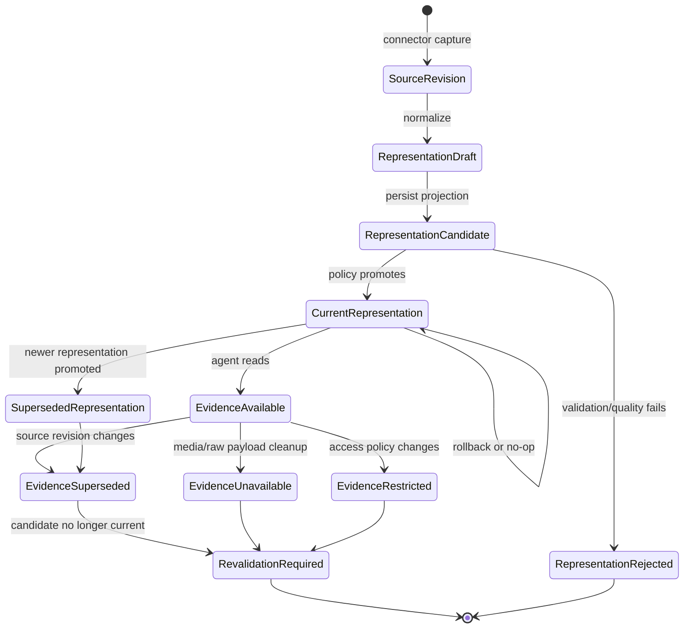

# Story 内容表示与多模态阅读架构设计

状态：`accepted`（目标架构已确认，尚未实现）
日期：`2026-10-08`

决策者：维护者。已批准目标设计与技术决定；本文件不是当前实现规格。实施计划归属 Task 40；本文不授予业务实现、迁移或发布权限。

关联目标设计：[`2026-10-08-story-content-representation-design.md`](./2026-10-08-story-content-representation-design.md)

## 1. 架构目标

本架构把来源内容、规范化阅读投影、Story 语义表示和 Agent 读取边界分开，同时保持 Web 和 Agent 使用同一套内容读取规则。

架构必须满足：

1. 来源修订是不可变事实，解析器升级不能伪造来源修订；
2. `ContentRepresentation` 是 `EntryRevision` 的受管子资源，不成为第二份内容真相；
3. Connector 不拥有 Cosmos 的阅读合同；
4. Web 和 Agent 不直接读取 Prisma、Blob key 或内部 JSON；
5. 内容解析失败不阻塞文本和元数据入库；
6. 当前内容表示的选择可审计、可回退、可复现；
7. Agent 不能通过读取 profile 越权获得原始敏感内容或媒体字节；
8. 旧 `contentText` 数据和现有 Story/Entry 读取合同继续可用。

## 2. 当前边界与目标差异

当前已具备 NormalizedIngestItem、EntryRevision.contentText、Observation、Asset/Blob、StoryRevision、API/Transport 和 Agent Invocation。缺口是有序内容块、共享 Normalizer、版本化表示及指针、统一 Query/访问策略。阅读页文本与媒体分开展示（从代码推断，未做本轮浏览器验证）。

## 2.1 总体架构图

这张图展示运行时边界和依赖方向。内容语义由 Domain/Contracts 定义，Application 负责编排与读取策略，Storage/Blob 只提供持久化能力，Web/Agent 不能绕过 Query owner。



## 3. 模块所有权

### 3.1 Connector

Connector 负责：

- 从外部来源读取内容；
- 映射来源字段为 `NormalizedIngestItem`；
- 提供原始内容格式声明；
- 提供媒体候选、来源定位和来源特有扩展；
- 提供原始 payload 输入和媒体 source URL。

Connector 不负责：

- 定义 Cosmos 内容块合同；
- 直接写 `ContentRepresentation`；
- 决定 Story 当前表示；
- 解析 `ContentKind` 以外的跨来源阅读语义；
- 直接访问 Prisma、Blob Root 或 Agent。

### 3.2 Domain

`packages/domain` 拥有纯领域类型和算法：

- `ContentBlock` discriminated union 的领域类型；
- `ContentRepresentationDraft` 领域类型；
- `representationStatus`、媒体状态和 evidence availability 语义；
- 内容块规范化、稳定 block ID、纯文本投影和指纹算法；
- Story/Entry/Revision 之间不变量的纯校验辅助。

Domain 不依赖 HTTP/Workflow 的 Zod schema，不访问网络、数据库、Blob 或时钟以外的外部资源，不拥有 Application 的权限策略。

### 3.3 Contracts

`packages/contracts` 是跨边界 JSON 合同的唯一 owner，拥有：

- ContentBlock wire schemas；
- ContentRepresentation snapshot/draft/result schemas；
- Content Query profile、输入和输出 DTO；
- EvidenceRef、availability 和 parse warning schemas；
- Agent 读取范围和能力边界的公开枚举；
- 向后兼容的 `contentText` 字段和旧 DTO 结构。

Domain 不复制这些 Zod schema；Storage 不把 Prisma JSON 直接当作公共合同；Web 和 Agent 不各自定义内容解释。

### 3.4 Application

Application 拥有内容处理和读取策略：

- `ContentNormalizer`：把 Connector 输入转为 draft；
- `RepresentationPolicy`：评估状态、质量信号、晋升和回退；
- `ContentQuery`：统一读取 owner；
- `ContentAccessPolicy`：profile、来源敏感级别、目标范围和媒体字节授权；
- domain draft、storage projection、Web/Agent DTO 之间的转换；
- Blob 暂存与数据库提交之间的编排；
- legacy fallback、evidence availability 和媒体能力投影。

Application 不拥有 Prisma schema 或 Blob 字节，不把权限判断交给 Agent，不让 Query 在每次读取时动态选择另一个表示。

### 3.5 Storage

`packages/storage-prisma` 拥有持久化实现：

- `Observation` 原始证据引用；
- `EntryRevision` 来源修订；
- `ContentRepresentation` 子资源；
- `EntryRevision.currentRepresentationId` 指针；
- `Asset` 元数据和媒体引用；
- 原子写入、同属关系校验、版本唯一性和级联生命周期；
- 按 Application 授权执行读取。

Storage 不重新计算解析质量，不定义 Agent profile，不从多个表示中自行挑选当前版本，不直接暴露 Prisma/Blob 内部结构。

### 3.6 Blob Store

Blob Store 只拥有字节能力：

- 暂存和写入 Blob；
- 内容完整性校验；
- 读取已授权的 Blob；
- 删除未绑定或已到期的 Blob。

Blob Store 不拥有 Observation、EntryRevision、Asset 或 ContentRepresentation 语义，不判断调用方是否有权读取敏感来源。

### 3.7 Web 与 Agent

Web 和 Agent 都通过版本化 Service/Query 合同访问内容：

- Web 使用 `story-reading` 投影；
- Agent 使用 `agent-summary`、`agent-structured`、`agent-evidence` 或 `media-bytes` profile；
- Web/Agent 不解析原始 HTML；
- Web/Agent 不直接访问 Prisma、Blob Root、内部 Blob key 或 `contentBlocksJson` 原始存储字段。

## 4. 依赖方向

依赖约束：

- Domain 可以被 Application 和 Storage adapter 使用，但不反向依赖 Storage；
- Application 依赖 Domain、Contracts 和抽象 Storage/Blob ports；
- Storage 实现 Application 声明的 ports，并依赖 Domain 的持久语义；
- Transport/API 依赖 Application Query 和 Contracts；
- Web 和 Agent 依赖 Transport/Service，不依赖 Storage 实现；
- Connector 依赖 Domain/Application 的输入端口，不依赖 Web、Story 阅读组件或 Prisma。

不得新增一条 Web/Agent 直达 Storage 的捷径。

## 5. 写入处理流

### 5.1 正常采集路径

Connector 声明格式，Normalizer 纯转换为 draft，不访问网络、数据库、Blob 或 Agent。Application 沿用现有媒体获取策略；以下时序图定义提交边界。

### 5.2 采集写入时序图

下面的时序图强调：Normalizer 是纯处理；Blob 先暂存；Storage 事务原子绑定数据库记录；失败时不产生公共可见的半成品引用。



### 5.3 Blob 与数据库的两阶段边界

Blob 不参与数据库事务：先暂存字节，事务校验并绑定 Observation、Revision、表示和 Asset 引用，成功后确认绑定。失败或中断的未绑定 Blob 进入清理候选，公共读取不可见；清理须以已提交引用为准，不能误删已绑定但尚未确认的字节。

不得提交不存在的 Blob 引用；`metadata_only`、`skipped`、`failed` 不创建媒体 Blob。

### 5.3 解析失败路径

```text
complete -> 保存完整 ContentRepresentation，允许晋升
partial  -> 保存块、unknown 和 warnings，按策略决定是否晋升
failed   -> 保存失败状态和 warnings，读取侧 fallback 到 contentText
```

解析失败不回滚 Observation、Entry 或 EntryRevision。失败原因进入表示投影和可读降级状态，不伪造结构化内容完整性。

## 6. 持久化模型与不变量

### 6.1 数据所有权关系图

下面的图区分来源事实、阅读投影、媒体字节和 Story 语义，避免把 Blob Store 或 Story 当成所有内容的共同 owner。



`ContentRepresentation` 是 `EntryRevision` 的受管子资源，不是独立内容身份。第一版不建独立 `ContentBlock` 表，块作为表示记录中的有序 JSON 数组保存。图中的 `EVIDENCE_REF` 是逻辑投影，不要求第一版立即新增同名物理表。

### 6.2 持久化不变量

1. 每个 `ContentRepresentation.entryRevisionId` 必须指向存在的 `EntryRevision`；
2. `currentRepresentationId` 必须指向同一 `EntryRevision` 的表示；
3. `(entryRevisionId, representationVersion)` 唯一；
4. 表示记录不改变所属 `EntryRevision` 的来源字段；
5. 表示版本变化不创建 `EntryRevision`；
6. 来源内容变化创建新的 `EntryRevision`，不改写旧表示；
7. 旧表示在其证据/保留策略允许前不可被静默覆盖；
8. 已保存媒体的 Asset 引用必须对应完整 Blob；
9. Observation raw payload 不由 ContentRepresentation 复制或拥有；
10. Story/Agent 证据必须绑定输入修订和实际表示版本；
11. 历史 Agent 结果不能自动迁移到新的 EntryRevision 或表示；
12. 旧 `contentText` 仍可作为兼容读取输入。

### 6.3 Application 选择、Storage 执行

```text
Parser -> draft
Application RepresentationPolicy -> promote/rollback command
Storage -> 校验归属并原子写入 current 指针
ContentQuery -> 只读取 currentRepresentationId
```

Application 负责 `complete > partial > failed`、质量信号、人工锁定和回退策略。Storage 不按版本号排序、不计算质量。Query 不在读取时重新选择表示，以保证同一引用可复现。

## 7. 读取架构

### 7.1 统一 Content Query owner

Application 的 `ContentQuery` 是 Web 和 Agent 的共同读取 owner，负责：

- Story alias/canonical 解析；
- 当前 StoryRevision 选择；
- 当前 ContentRepresentation 读取；
- `legacy-text` fallback；
- Asset 状态和能力投影；
- evidence availability 计算；
- producer/version/provenance 投影；
- profile 与访问策略检查。

HTTP/API/Agent Tool 可以拥有不同的外层 DTO，但必须由同一个 Query owner 投影，不能各自解析内容。

### 7.2 读取 profiles



受管 profiles：

```text
story-reading
  Story 当前表示 + 主来源内容块 + 来源成员摘要 + 媒体能力

agent-summary
  Story 当前表示 + 成员摘要 + 基本来源信息

agent-structured
  Story 表示 + EntryRevision + current representation blocks
  + media metadata + relations + evidence refs

agent-evidence
  受控原始 payload 投影 + 结构化内容 + evidence availability

media-metadata
  媒体类型、状态、尺寸、来源、降级原因和 Asset 摘要

media-bytes
  单独授权后的特定 Asset 字节读取
```

Profile 是受管集合，不接受任意字段选择。读取结果带有表示状态、EntryRevision、representationVersion、parserVersion、媒体状态和证据 availability。内部 Blob key 和数据库字段组合规则不出现在公开结果中。

### 7.3 Story 多 Entry 投影

第一版不增加 `Story.primaryEntryId`。Application 的主来源选择器生成稳定读取投影：未来用户指定主来源时优先；当前没有时依次使用首个主成员、内容完整度/来源可信度、按 Story kind 的时间规则和稳定 ID 兜底。投影必须返回主来源标记和选择原因。

单 Entry Story 直接提供该 Entry 的当前内容块。多来源 Story 不无提示拼接正文：`event` 以 Story 表示和证据为主，`document` 支持来源切换，`media` 以主媒体为主，`thread` 保留 Entry 顺序和边界。

## 8. Agent 访问与安全边界

### 8.1 Access Policy

Application 的 `ContentAccessPolicy` 是 Agent 读取授权 owner。Agent 只能申请受管 profile、目标对象范围和任务原因。Policy 校验：

- 调用方能力；
- Story/Entry 目标范围；
- 来源敏感级别；
- 原始证据权限；
- Asset 和媒体字节权限；
- 调用预算和数据范围。

Storage 只执行已授权的读取，Blob Store 只读取已授权的 Blob。Agent 不得通过组合多个低权限查询推导出被禁止的高权限数据。

### 8.2 默认与拒绝

- 默认从 `agent-summary` 开始；任务明确选择来源结构后使用 `agent-structured`；
- `agent-evidence` 和 `media-bytes` 必须单独授权；
- 敏感来源默认禁止原始 payload 和媒体字节；
- 凭据、脚本、追踪数据不进入内容投影；
- 拒绝返回 `access-restricted` 或 `unavailable`，不返回敏感片段；
- 读取事件记录 profile、调用方、目标范围、输入版本和拒绝原因。

### 8.3 外部内容不可信

原始 HTML、JSON、文本和 Agent 生成内容都是数据，不是系统指令。原始 HTML 不在 Web 阅读页执行或直接渲染；块规范化器删除脚本、事件属性和不安全结构。Agent 工具只能接收受控投影，不能把来源内容当作可执行配置。

## 9. 兼容与演进

### 9.1 旧数据

ContentQuery 读取优先级：

```text
current ContentRepresentation -> structured
无表示但有 contentText       -> legacy-text paragraph
无正文但有媒体               -> media-only degraded
都没有                       -> empty + 原文入口
```

不做一次性历史回填，不伪造旧数据的 parserVersion。旧 `StoryDetail`、`EntryRevisionSnapshot.contentText` 和既有 Asset snapshot 保持兼容；新字段 additive 增加。

### 9.2 表示版本与证据生命周期图

来源修订、内容表示和 Agent 结论拥有不同生命周期。解析器升级只产生新的表示；来源修订变化不会改写旧证据；证据失效时结论降级而不是静默迁移。



Parser 升级创建新的 ContentRepresentation，不创建新的 EntryRevision。当前指针的晋升/回退由 Application Policy 生成命令，Storage 用同一事务约束执行。旧表示和旧 Agent 证据在清理前继续可审计。

### 9.3 内容块演进

Contracts 维护内容块 schema 版本。新增块类型必须：

- 有版本化合同；
- 在旧客户端读取侧安全降级为 `unknown`；
- 不改变既有块的字段语义；
- 有 parser/normalizer focused tests；
- 明确 Web、Agent 和证据投影影响。

第一阶段不把块拆成独立表。只有字符级证据、块级批注、单块检索或跨文档引用成为稳定需求时，才重新评估持久化形态。

## 10. 失败、回退与恢复

| 场景 | Application 行为 | 公共读取结果 |
| --- | --- | --- |
| 解析完整 | 生成并晋升表示 | `structured/complete` |
| 部分解析 | 保存 unknown 和 warning | `structured/partial` |
| 解析失败 | 保存失败表示，不阻塞 Entry | `degraded` 或 `legacy-text` |
| 当前表示异常 | 生成回退命令 | 上一个可用表示 |
| 没有可用表示 | 不创建假表示 | `legacy-text` 或 `empty` |
| Asset skipped/failed | 保留来源 URL 和原因 | 降级媒体块 |
| Asset Blob 缺失 | 标记引用不可用 | `media-unavailable` |
| 原始证据被清理 | 保留引用/审计状态 | `deleted` |
| 权限收紧 | 不返回内容 | `access-restricted` |
| Entry 新 Revision | 保留旧证据，不自动迁移 | `source-revision-superseded` |
| Blob/DB 提交失败 | DB 不绑定暂存 Blob | 未绑定 Blob 进入清理候选 |

## 11. 架构不变量与验证

### 11.1 不变量

1. Web 和 Agent 的内容解释只能来自 Application Content Query；
2. Storage 是持久化真相，Blob Store 不是内容语义真相；
3. EntryRevision 是来源修订真相，ContentRepresentation 是可重建投影；
4. StoryRevision 是规范表示真相，不复制来源正文；
5. Agent 候选不能越过确认边界直接覆盖用户真相；
6. 所有派生结果携带 producer、version、输入版本和 evidence；
7. 原始内容按不可信数据处理，不执行、不作为指令；
8. 当前表示选择可追溯且不由读取时动态猜测；
9. 旧数据和旧读取合同继续可用；
10. 失败和权限降级必须可见，不能用空白或假成功掩盖。

### 11.2 验证层次

[Task 40 实施计划](../../../.agents/tasks/40-story-content-representation/walkthrough.md)逐切片列出 Domain/Contracts、Application、Storage、API/Transport、Web、Agent 与迁移的行为验证；这些层次分别报告，不相互替代。

## 12. 实施计划归属

实施计划已移入 [Task 40 唯一过程记录](../../../.agents/tasks/40-story-content-representation/walkthrough.md)，任务摘要见 [Task 40](../../../.agents/tasks/40-story-content-representation/README.md)。本文件维护目标架构，不重复跟踪实施状态与验证结果。

## 13. 架构决策记录

| 序号 | 已确认架构决定 |
| --- | --- |
| 1 | `ContentRepresentation` 是 `EntryRevision` 的持久子资源；解析由 Application 拥有；Web/Agent 通过统一读取投影访问 |
| 2 | 共享 Content Normalizer 属于 Application，采集时同步生成 draft，与 EntryRevision 原子保存 |
| 3 | Domain 拥有领域类型与纯算法，Contracts 拥有公共 JSON/DTO schema，Application 转换，Storage 不暴露内部 JSON |
| 4 | Web/Agent 共用 Application ContentQuery owner，通过 profile 控制字段和权限 |
| 5 | `ContentRepresentation` 使用独立持久化记录，内容块仍存 JSON，由 `currentRepresentationId` 选择 |
| 6 | 原始 payload 归 Observation 所有，EntryRevision 只保存证据引用，字节统一由 Blob Store 保存 |
| 7 | Blob 先暂存，数据库事务原子绑定，失败由未绑定 Blob 清理 |
| 8 | Application ContentQuery 提供多个版本化 profile，Web/Agent 各自包装，旧读取合同兼容 |
| 9 | Application 负责表示质量和晋升/回退，Storage 执行原子写入与指针约束，Query 只读 current 指针 |
| 10 | Application ContentAccessPolicy 统一授权，Agent 只能申请受管 profile，Storage/Blob Store 不扩大权限 |

## 14. ADR 信号与后续决策

本架构涉及以下稳定架构面，实施前应单独记录 ADR 或更新现有 ADR：

- 新的 `ContentRepresentation` 持久子资源和 `currentRepresentationId`；
- ContentBlock 公共 wire 合同及版本演进；
- Observation raw payload 与 Blob Store 的所有权关系；
- Web/Agent 统一 ContentQuery 与 profile 边界；
- Agent 原始证据、媒体字节和敏感来源的访问策略；
- 表示版本、证据引用和清理/回退生命周期。

尚未冻结为实现合同的项目：质量信号的具体算法、原始 payload 具体保留天数、具体 Prisma 表字段命名、Agent tool 名称、未来权限系统的角色模型。这些不能由实现代理自行猜测为长期公共行为。
